# Ótica Support

Site de uma ótica para **vender óculos de sol online** e **agendar consultas de vista**, com um painel para o dono acompanhar pedidos e consultas.

> Entrega 1 do Trabalho Final (protótipo). O sistema completo será entregue na segunda parte.

## Integrantes

| Nome | GitHub | Responsabilidade |
|---|---|---|
| [Fernando Teodoro Lima Dutra] | [@usuario](https://github.com/Limalls) | [ex.: front-end da loja] |
| [Luis fernando Da Silva Bento] | [@usuario](https://github.com/Luis-Fernando9) | [ex.: API e banco de dados] |
| [Sergio Emmanuel De Campos Queiroz] | [@usuario](https://github.com/ser589) | [ex.: painel do dono] |
| [Caua De Oliveira Lima] | [@usuario](https://github.com/cauacode_) | [ex.: API e banco de dados] |

## Trilha escolhida

Vendas e agendamento

**[Vendas e agendamento]**

## O problema que o sistema resolve

Muitas óticas pequenas ainda marcam consultas de vista por telefone ou WhatsApp e vendem óculos só no balcão. Isso causa problemas que aparecem no dia a dia:

- **Consultas marcadas de forma desorganizada.** O horário depende de quem atendeu a mensagem, e dois clientes podem ser marcados no mesmo horário ou o horário pode ser esquecido.
- **Cliente sem informação.** Ele só descobre se o modelo que queria está em estoque quando chega na loja.
- **Dono sem visão geral.** Pedidos e consultas ficam espalhados em conversas e cadernos, e é difícil saber o que já foi atendido.
- **Venda limitada ao horário da loja.** Quem não pode ir até lá não consegue comprar nem marcar consulta fora do expediente.

O **Ótica Support** reúne tudo em um só lugar: o cliente vê o catálogo, compra e escolhe o horário da consulta sozinho, e o dono acompanha tudo em um painel.

## Como o sistema é dividido

O sistema tem três partes, cada uma em seu repositório.

| Parte | O que faz | Repositório |
|---|---|---|
| **Site da loja (front-end)** | Catálogo, carrinho, checkout e agendamento para o cliente | [Otica_Support_Front](https://github.com/Limalls/Otica_Support_Front)|
| **API (back-end)** | Regras de negócio, banco de dados e autenticação | [Otica_Support_Back](https://github.com/Limalls/Otica_Support_Back) |
| **Painel do dono** | Pedidos, consultas e cadastro de produtos | [Otica_Support_Painel](https://github.com/Limalls/Otica_Support_Painel) |

### Funcionalidades do MVP

- Agendamento de consultas, com escolha de dia e horário livre
- Catálogo de óculos, com busca, filtro por categoria e ordenação
- Carrinho e checkout
- Área do dono, com login, cadastro de produtos e acompanhamento de pedidos e consultas

## Protótipo

O protótipo foi feito em React, com dados de exemplo (ainda **não** está ligado à API) e as ilustrações de óculos desenhadas em SVG, no lugar de fotos reais.

**Link do protótipo:**  não publicado. Para ver rodando, siga a seção [Como rodar o protótipo](#como-rodar-o-protótipo).

### Login (acesso do dono)

Valida e-mail e senha e mostra o erro ao lado de cada campo.

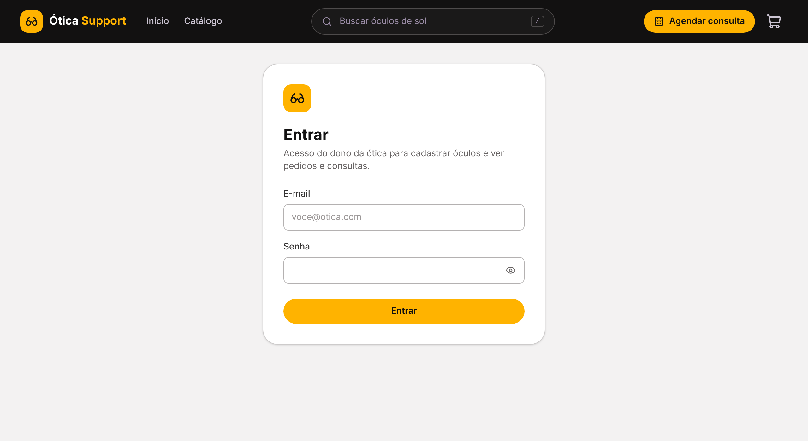

### Listagem (catálogo)

Lista os óculos com filtro por categoria, ordenação por preço e a busca da barra superior. O modelo esgotado recebe uma etiqueta.

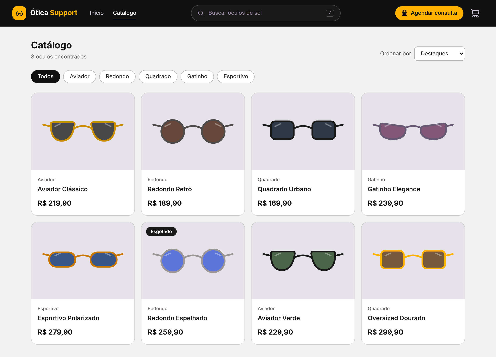

### Detalhe do produto

Mostra preço, estoque, descrição e características. O cliente escolhe a quantidade e adiciona ao carrinho, e o contador do carrinho no topo atualiza.

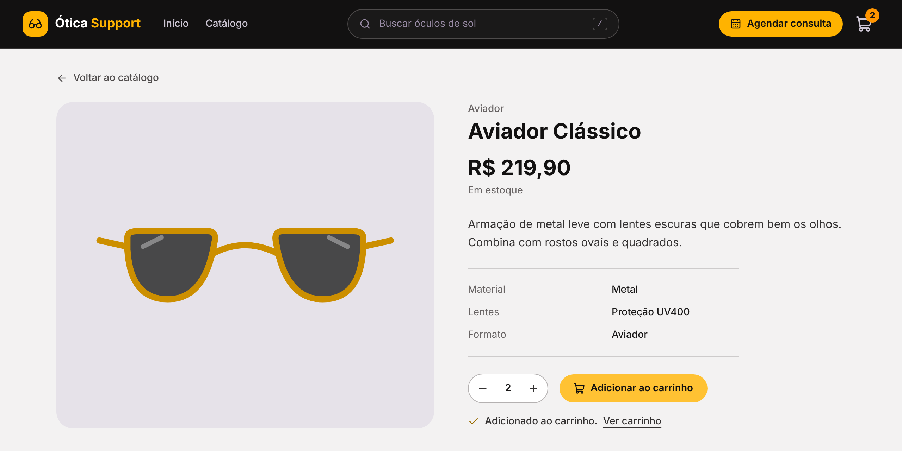

### Cadastro de produto (área do dono)

Formulário com validação e uma pré-visualização que muda enquanto o dono digita.

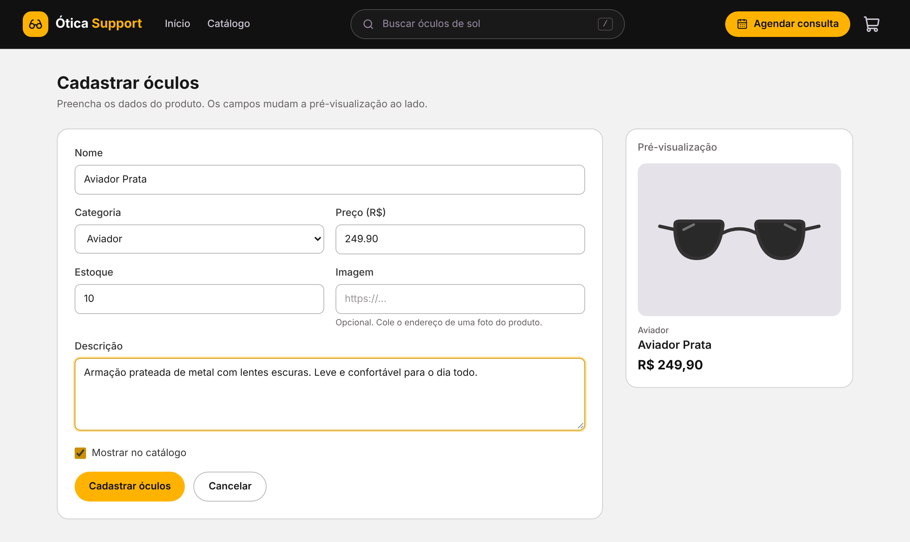

Quando o formulário é enviado com campos inválidos, os erros aparecem sob cada campo:

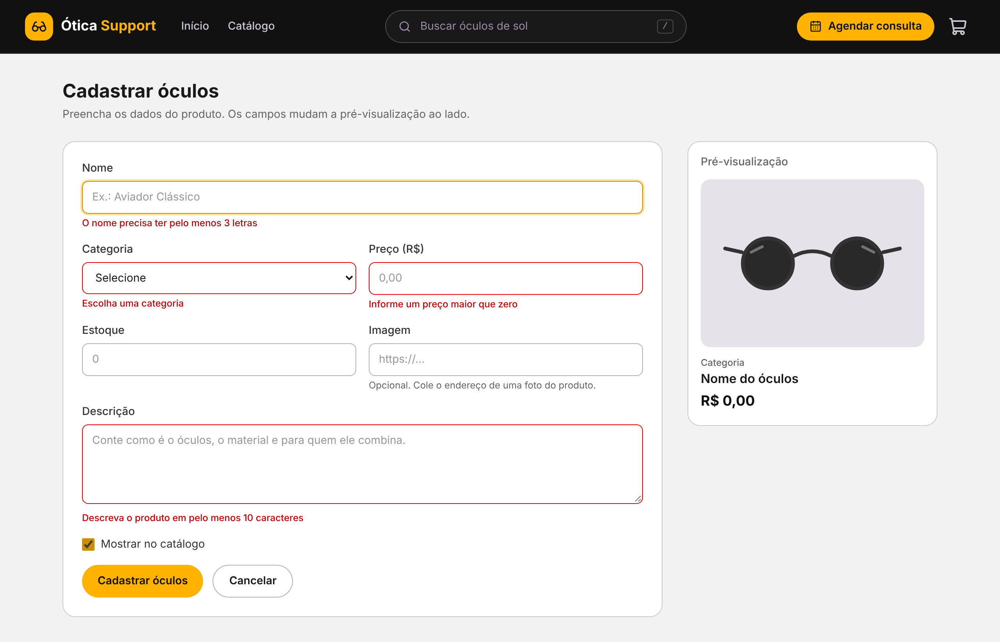

### Agendamento de consulta

O cliente escolhe o dia e um horário livre (os ocupados aparecem riscados) e informa seus dados.

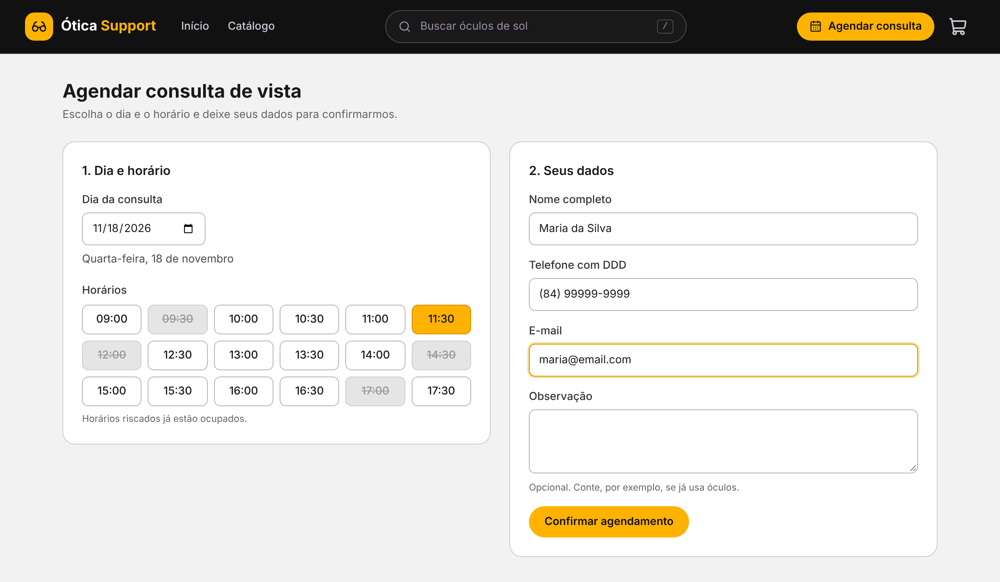

### Outras telas

| Início | Listagem no celular |
|---|---|
| 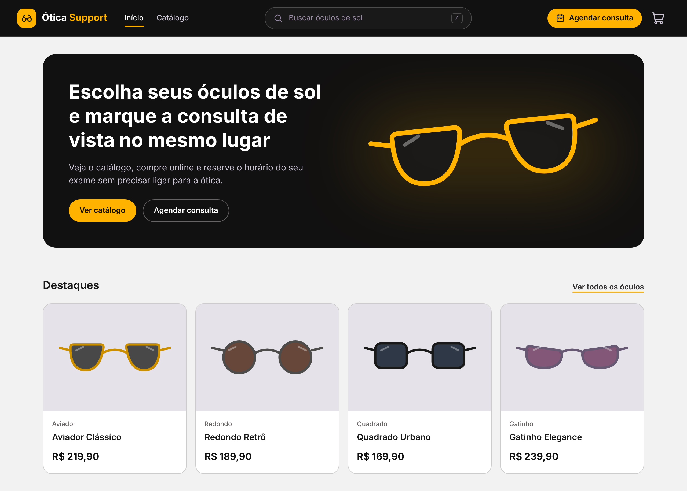 | 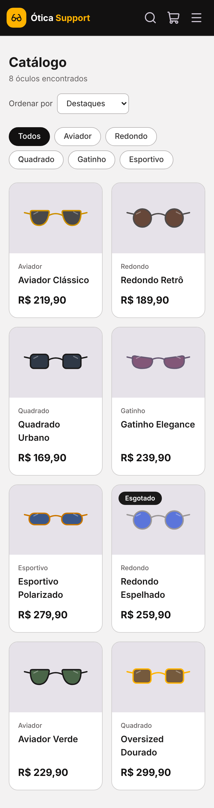 |

| Carrinho | Busca sem resultado |
|---|---|
| 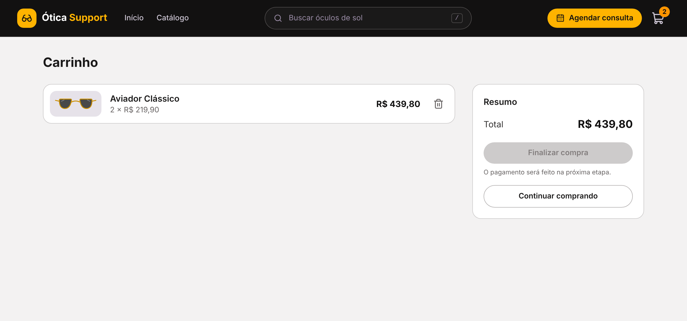 | 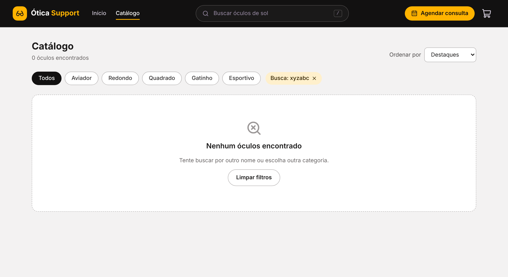 |

## Modelagem do banco de dados

Banco relacional (PostgreSQL). O diagrama mostra as entidades, os atributos e os relacionamentos.


`PK` é chave primária, `FK` é chave estrangeira e `UK` é valor único.

<details>
<summary>Código do diagrama (Mermaid, o GitHub desenha sozinho)</summary>

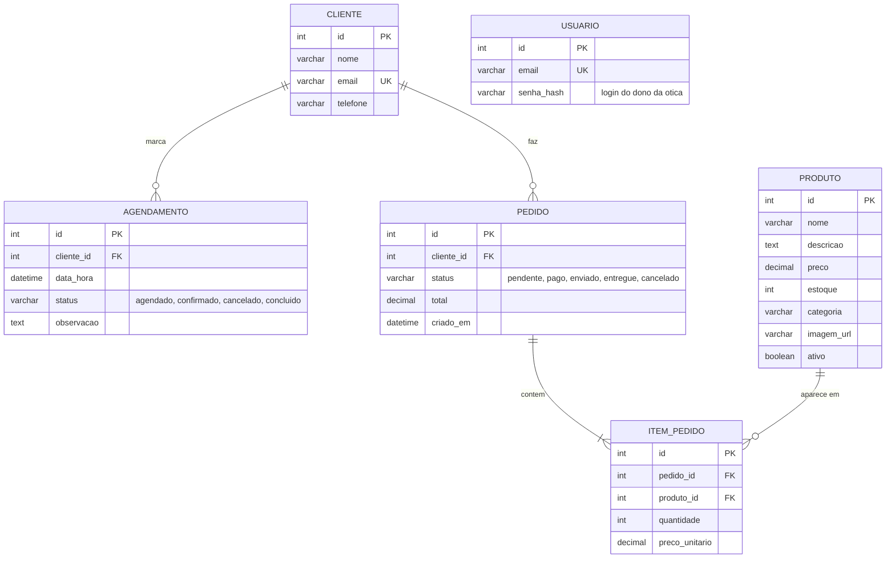

</details>

### Entidades e relacionamentos

| Entidade | O que representa |
|---|---|
| **Cliente** | Quem compra ou marca consulta. Não precisa de senha. |
| **Agendamento** | Uma consulta de vista, com data, horário e situação. |
| **Produto** | Um modelo de óculos do catálogo. |
| **Pedido** | Uma compra feita por um cliente. |
| **Item do pedido** | Cada produto dentro de um pedido, com a quantidade. |
| **Usuário** | O dono da ótica, que acessa o painel. |

- Um **cliente** pode ter vários **agendamentos** e vários **pedidos** (1 para N).
- Um **pedido** tem um ou mais **itens**, e cada **item** aponta para um **produto** (um produto pode aparecer em vários pedidos).
- **Usuário** é independente dos outros: só controla o acesso do dono.

### Decisões da modelagem

- **`preco_unitario` fica no item do pedido.** Se o preço do produto mudar depois, os pedidos antigos continuam com o valor que o cliente pagou.
- **Produto tem `ativo` em vez de ser apagado.** Um produto que já foi vendido não pode sumir do histórico dos pedidos.
- **Cliente e Usuário são tabelas separadas.** O cliente compra sem criar conta, e só o dono tem senha.
- **O total do pedido é calculado pela API**, com os preços do banco, e nunca com o valor enviado pelo site.
- **`status` guarda valores fixos** (por exemplo, pendente, pago, enviado), o que facilita filtrar no painel.

## Tecnologias

| Parte | Tecnologias |
|---|---|
| Front-end | React (JavaScript), Vite, Tailwind CSS, React Router, React Hook Form, Zod, Zustand |
| Back-end | Python, FastAPI, SQLAlchemy, Alembic |
| Banco de dados | PostgreSQL |
| Organização | Git e GitHub (issues, milestones e pull requests) |

## Como usamos IA

**Ferramenta:** Claude (Anthropic), pelo chat do claude.ai com execução de código.

Usamos a IA como apoio em todas as etapas, mas as decisões de escopo, de stack e do que entra no projeto foram do grupo. Abaixo, os principais pedidos (prompts), o que aproveitamos e o que mudou.

<!-- AJUSTAR: confiram cada linha e acrescentem o que VOCÊS fizeram ou mudaram à mão. Se usaram outra ferramenta (v0, Lovable, Copilot...), listem também. A seção precisa ser fiel ao que o grupo realmente fez. -->

| Etapa | Prompt (resumo) | O que ficou | O que mudou |
|---|---|---|---|
| **Base do repositório da API** | "Vamos começar fazendo a base do repositorio. apenas o essencial primeiro." | `.gitignore`, `.editorconfig`, `.env.example`, LICENSE, README, CONTRIBUTING e templates de issue e de pull request, em 3 commits. | Os outros commits ficaram reservados para o código. |
| **Issues da API** | "Pode me ajudar a pensar nas primeiras issues? sendo elas duas para estrutura inicial e 5 para MVP." | 7 issues em ordem de implementação (estrutura, modelos, catálogo, agendamento, pedidos, login e painel). | Discutimos separar o trabalho em duas milestones: uma para a entrega do if e outra para um lançamento real no futuro. |
| **Protótipo e modelagem** | Podemos fazer a modelagem do prototipo? preciso de telas para fazer a visualizaçao do produto pelo menos para essa etapa| As 5 telas, a validação dos formulários, o carrinho e o diagrama com 6 entidades. | [Descrevam aqui o que o grupo alterou depois]. Durante os testes, a própria IA corrigiu a data do agendamento (estava com letras maiúsculas demais) e dois avisos de boas práticas do React. |

### Como conferimos o que a IA entregou

- **Conferência feita pela IA:** ela rodou `npm run build` e `npm run lint` e testou os fluxos principais em um navegador automatizado (login com erro e com sucesso, filtro e busca no catálogo, adicionar ao carrinho, validação do cadastro e envio do agendamento). Também verificou que nenhuma tela cria rolagem horizontal no celular.
- **A IA errou em pelo menos um ponto:** ela afirmou que o template do Vite já vinha com ESLint, mas o template atual vem com o **Oxlint**. Ela mesma percebeu o erro ao rodar o `npm run lint` e avisou o grupo.

### Limites que reconhecemos

- Os dados do protótipo (produtos, preços e horários livres) são **exemplos inventados**, e as imagens são ilustrações.
- O que a IA gera precisa ser lido e testado, porque ela pode afirmar coisas erradas com segurança.

## Como rodar o protótipo

Pré-requisito: Node.js 20 ou superior.

```bash
git clone [link do repositório do front]
cd [pasta do repositório do front]
npm install
npm run dev
```

O site abre em http://localhost:5173. Rotas do protótipo:

| Rota | Tela |
|---|---|
| `/` | Início |
| `/catalogo` | Listagem |
| `/produto/1` | Detalhe |
| `/carrinho` | Carrinho |
| `/agendamento` | Agendamento |
| `/login` | Login do dono |
| `/admin/produtos/novo` | Cadastro de produto |

No login, qualquer e-mail válido com senha de 6 ou mais caracteres entra, porque ainda não há API.

## Estrutura deste repositório

```
.
├── README.md
└── docs/
    ├── modelagem/    # diagrama do banco (imagem e código Mermaid)
    └── prototipo/    # prints das telas
```

## Licença

Distribuído sob a licença MIT.
